<p align="center">
  
</p>

<h1 align="center">Veritus AI</h1>
<p align="center"><b>Check it before you share it.</b><br/>
A privacy-first misinformation checker for the web, Android and Chrome.<br/>
Built by team <b>Bug Beaters</b> for Code//Connect '26 (Problem 03: Misinformation Control).</p>

<p align="center">
  <a href="https://veritusai.netlify.app"></a>
  <a href="https://verifi.fastapicloud.dev/docs"></a>
  
</p>

<p align="center">
  
  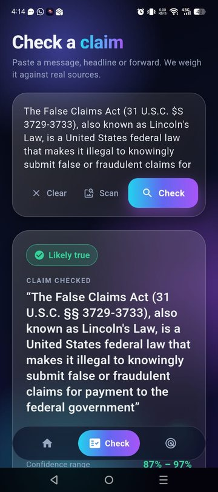
  
</p>

<p align="center">
  <a href="#-what-it-is">What it is</a> ·
  <a href="#-see-it">See it</a> ·
  <a href="#-features">Features</a> ·
  <a href="#-privacy-by-design">Privacy</a> ·
  <a href="#-how-it-works">How it works</a> ·
  <a href="#-quick-start">Quick start</a> ·
  <a href="#-api">API</a> ·
  <a href="#-deployment">Deployment</a> ·
  <a href="#-faq-and-troubleshooting">FAQ</a> ·
  <a href="#-team">Team</a>
</p>

---

## 🔎 What it is

Paste a forward, a headline or a screenshot. Veritus AI pulls out the claim that can actually be checked, searches trusted sources, and shows you the evidence with a **confidence range**. It never hands down a bare "true" or "false", and it leaves opinions, jokes, predictions and matters of faith alone, saying why.

It slows false news without censoring anyone: nothing is blocked or removed, people simply get evidence before they hit forward.

| Product | What it does | Docs |
| --- | --- | --- |
| 🌐 **Web app** | Home, claim checker, Rumor Radar, plus PIN-protected fact-checker and admin pages (Next.js, Netlify) | [web/](web/README.md) |
| 📱 **Android app** | Same features plus share-to-app from WhatsApp and screenshot scanning (Flutter) | [mobile/](mobile/README.md) |
| 🧩 **Chrome extension** | Select text on any page, right-click, check it (Manifest V3) | [extension/](extension/README.md) |
| ⚙️ **Backend API** | One shared API for all three (FastAPI) | [backend/](backend/README.md) |

**Live:** web app at <https://veritusai.netlify.app> · API at <https://verifi.fastapicloud.dev> (interactive docs at `/docs`).
The code and URLs use the working name `verifi`; the product name is Veritus AI.

---

## 📸 See it

Click a section to expand it.

<details open>
<summary><b>🌐 Web app</b></summary>

<br/>

**Home**

<p align="center">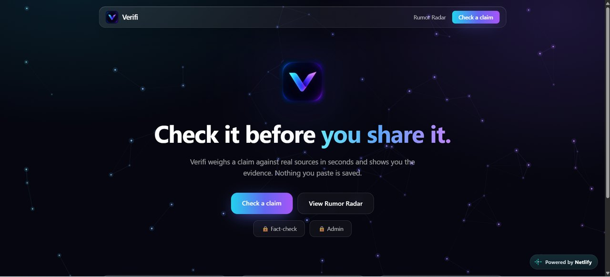</p>

**Check a claim** and **Rumor Radar**

<p align="center">
  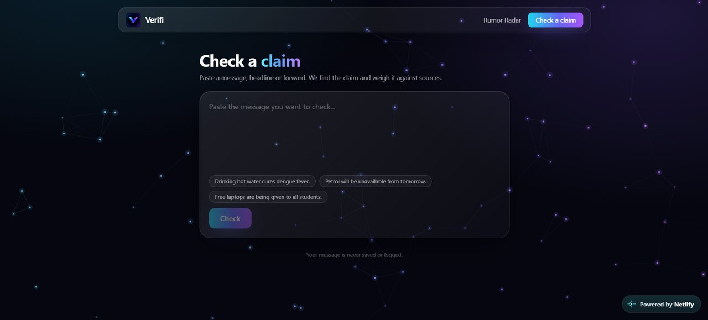
  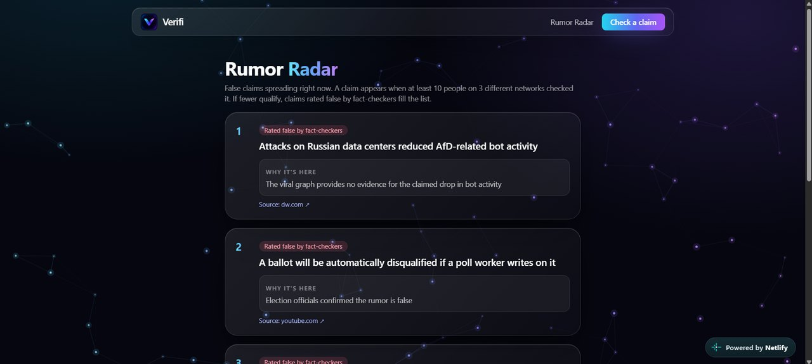
</p>

**PIN-protected tools:** PIN screen, fact-checker form and admin dashboard

<p align="center">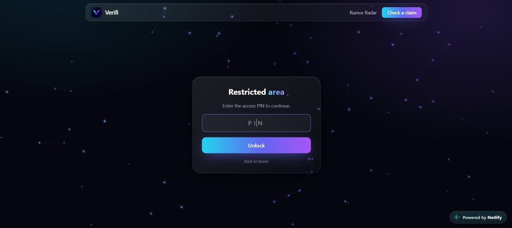</p>
<p align="center">
  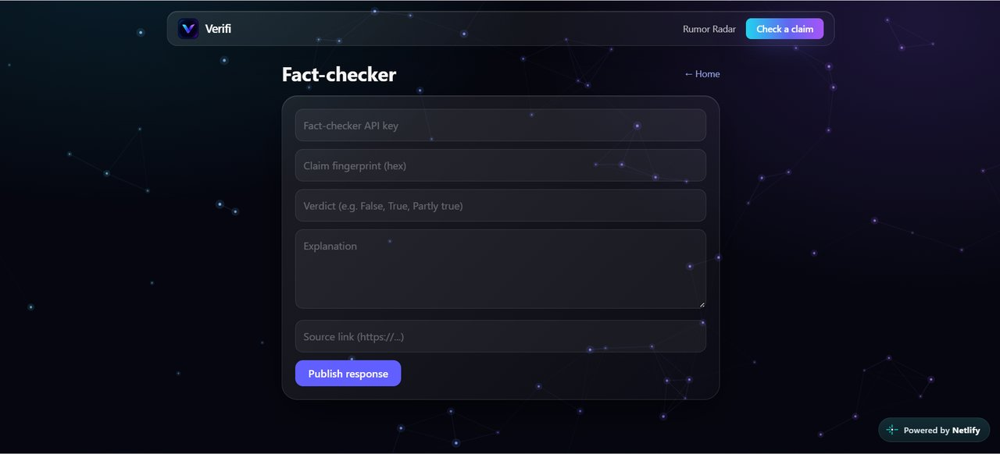
  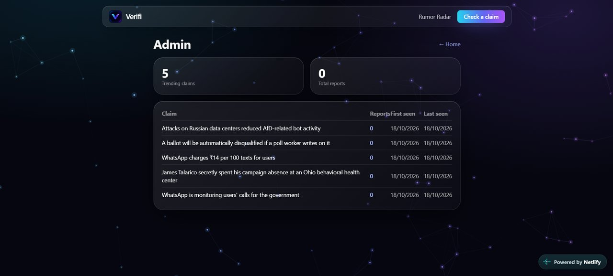
</p>

More in [web/README.md](web/README.md).

</details>

<details open>
<summary><b>📱 Android app</b></summary>

<br/>

<p align="center">
  
  
  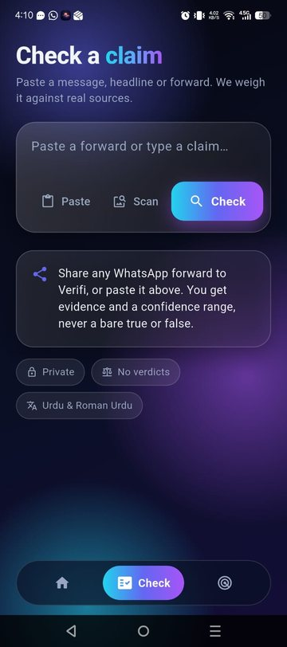
  
  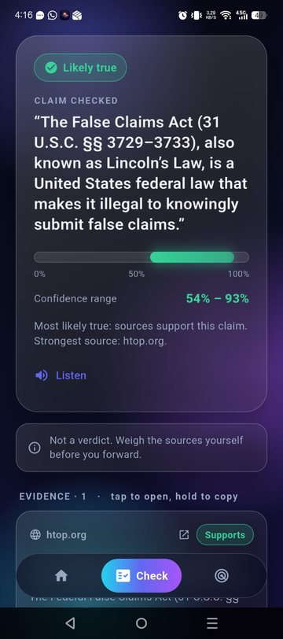
  
</p>

<p align="center"><sub>Splash · Home · Check · Result · Result with Listen and evidence · Rumor Radar</sub></p>

More in [mobile/README.md](mobile/README.md).

</details>

<details open>
<summary><b>🧩 Chrome extension</b></summary>

<br/>

<p align="center">
  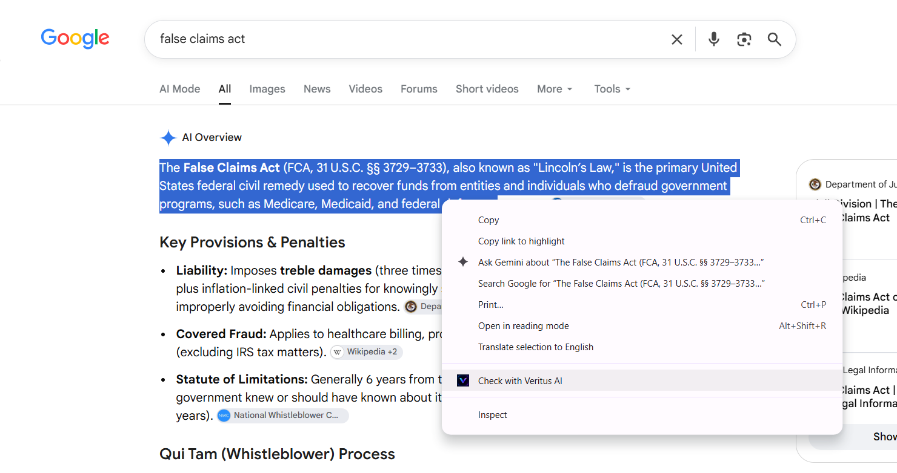
  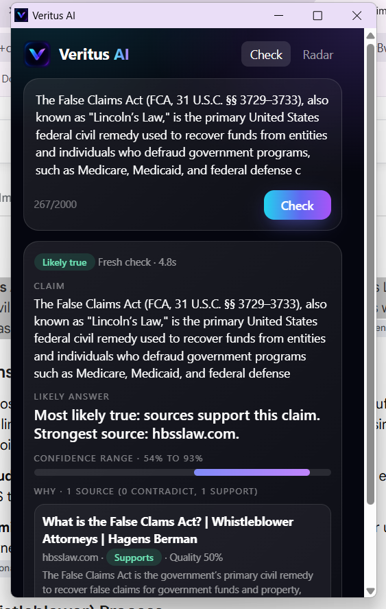
</p>

<p align="center"><sub>Right-click a selection to check it · Result window</sub></p>

<p align="center">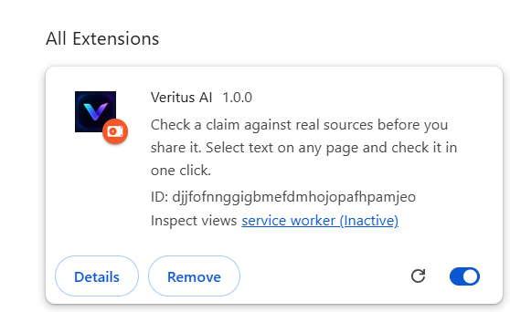</p>

More in [extension/README.md](extension/README.md).

</details>

---

## ✨ Features

| | Feature | Details |
| --- | --- | --- |
| 🧾 | **Evidence, not verdicts** | Every answer shows its sources, whether each supports or contradicts the claim, a source quality score and a confidence range |
| 🙅 | **Knows what not to judge** | Opinion, satire, faith and predictions are marked "Not rated" with a plain explanation of why and what to try instead |
| 📡 | **Rumor Radar** | A live list of false claims spreading now, each with a "Why it's here" note. Claims reported by at least 10 different installs on at least 3 different networks come first; fact-checker-rated false claims found on the web fill the list up to 5 |
| 🌍 | **English, Urdu and Roman Urdu** | Input is normalised so spelling tricks do not hide a claim |
| 📲 | **Share to check (Android)** | Share a WhatsApp forward or a screenshot straight into the app. Screenshots are read on the device |
| 🔊 | **Listen (Android)** | Results can be read aloud |
| 🧩 | **Check anywhere (Chrome)** | Select text, right-click, get the evidence in a small window |
| 🛠️ | **Fact-checker and admin tools (web)** | A PIN-protected form for publishing fact-checker responses, and a dashboard of trending claims and report counts |

<details>
<summary><b>What does a result look like?</b></summary>

<br/>

A checkable result contains the extracted `claim`, a `likely_answer`, a confidence range (`confidence_low` to `confidence_high`), and an `evidence[]` list. Each evidence item has a title, URL, publisher, stance (supports, contradicts or neutral), a quality score and a snippet.

Text that is not a claim returns `checkable: false` with a `reason_unchecked`, which the apps show as "Not rated" with the reason.

</details>

---

## 🔒 Privacy by design

- The text you check is **never stored or logged**. All state lives in memory for the length of one request.
- **No accounts.** Each install gets an anonymous, signed token that expires after 30 days.
- Cached lookups use a **fingerprint prefix** only: a client sends 4 hex characters, never the claim.
- The Rumor Radar stores only the claim fingerprint plus **salted hashes** of the install and of the coarse network (IPv4 /24 or IPv6 /48). No raw tokens, no IP addresses.
- The Chrome extension sends only the text you choose to check, stores only the anonymous token, and has no tracking.
- The web PIN screen is a **soft lock for casual visitors, not real security**. Do not protect anything sensitive with it.

<details>
<summary><b>What each part can see</b></summary>

<br/>

| Data | Client | Backend |
| --- | --- | --- |
| The text you check | Sent once to be checked | Used in memory for that request, never stored or logged |
| Claim fingerprint | Computed on the device (Android) | Kept with salted install and network hashes for the Radar |
| Install identity | Anonymous signed token | Verified, never tied to a person |
| IP address | n/a | Reduced to a coarse network, then salted and hashed |

</details>

---

## ⚙️ How it works

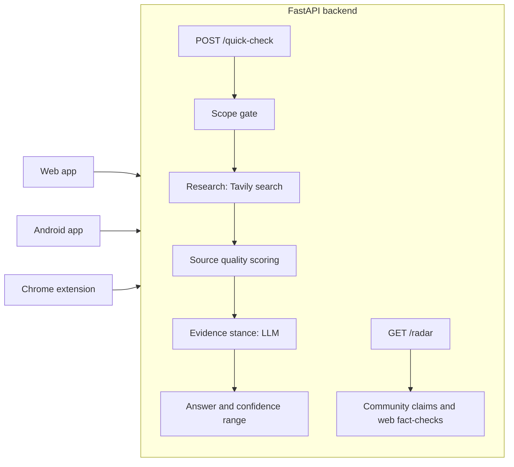

1. **Scope gate** decides whether the text contains a checkable claim and extracts it.
2. **Research** searches the web for the claim.
3. **Source scoring** rates each source's quality.
4. **Evidence** classifies each source as supporting, contradicting or neutral.
5. **Answer** combines everything into a likely answer and a confidence range.

<details>
<summary><b>Request sequence</b></summary>

<br/>

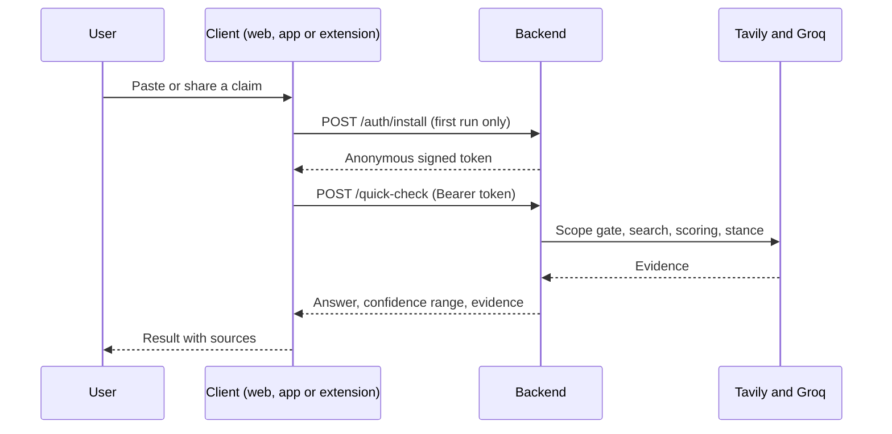

</details>

<details>
<summary><b>How the Rumor Radar picks claims</b></summary>

<br/>

`GET /radar` returns community claims first: claims checked by at least 10 different installs on at least 3 different networks, active in the last 168 hours. If fewer than 5 qualify, the list is topped up with recent false claims found by fact-checkers (Tavily search plus an LLM extraction, cached for 3 hours). Each item has an `origin` (`community` or `web`), a `why`, and for web claims a `source_url` and `publisher`.

</details>

---

## 🗂️ Repository layout

```
backend/     FastAPI app: api/ (routes, security), agents/ (research pipeline), core/ (fingerprint, normalise)
web/         Next.js 16 web app
mobile/      Flutter Android app
extension/   Chrome extension (MV3)
shared/      API contract (API.md) and shared data (normalize_map.json)
docs/        Logo and screenshots
```

<details>
<summary><b>Tech stack</b></summary>

<br/>

| Part | Stack |
| --- | --- |
| Backend | Python 3.11+, FastAPI, Tavily (search), Groq (LLM) |
| Web | Next.js 16 (App Router), React, TypeScript, Tailwind CSS v4 |
| Android | Flutter, on-device OCR, text to speech |
| Extension | Chrome Manifest V3, plain JavaScript |

</details>

---

## 🚀 Quick start

You need Python 3.11+, Node 20+, and Flutter if you want the app.

<details open>
<summary><b>1. Backend</b></summary>

```bash
# from the repo root
pip install -r backend/requirements.txt
cp .env.example .env            # add GROQ_API_KEY, GROQ_MODEL, TAVILY_API_KEY, set MOCK_MODE=false
uvicorn backend.app.api.main:app --reload --port 8000
```

Open <http://localhost:8000/docs>. Run tests with `python -m pytest backend/tests`.

</details>

<details>
<summary><b>2. Web</b></summary>

```bash
cd web && npm install
echo NEXT_PUBLIC_API_BASE=http://localhost:8000/api/v1 > .env.local
npm run dev                     # http://localhost:3000
```

</details>

<details>
<summary><b>3. Android app</b></summary>

```bash
cd mobile && flutter pub get
flutter run --dart-define=API_BASE=http://<your-pc-lan-ip>:8000
```

</details>

<details>
<summary><b>4. Chrome extension</b></summary>

1. Open `chrome://extensions` and turn on **Developer mode**.
2. Click **Load unpacked** and pick the `extension/` folder.
3. Pin Veritus AI from the puzzle icon.

</details>

> 💡 With `MOCK_MODE=true` (the backend default) the API returns fixed sample results and needs no keys, which is handy for UI work. The web app also has `NEXT_PUBLIC_USE_MOCK=true` to run with no backend at all.

---

## 🔌 API

| Method | Path | Purpose |
| --- | --- | --- |
| GET | `/health` | Liveness check |
| POST | `/api/v1/auth/install` | Get an anonymous install token |
| POST | `/api/v1/quick-check` | Check text and get evidence plus a confidence range |
| GET | `/api/v1/lookup/{prefix}` | Look up cached results by 4-hex fingerprint prefix |
| GET | `/api/v1/radar` | Rumor Radar items |

<details>
<summary><b>Try it with curl</b></summary>

```bash
B=https://verifi.fastapicloud.dev/api/v1
T=$(curl -s -X POST $B/auth/install -H 'Content-Type: application/json' -d '{}' | python -c 'import sys,json;print(json.load(sys.stdin)["install_token"])')
curl -s -X POST $B/quick-check -H "Authorization: Bearer $T" -H 'Content-Type: application/json' \
  -d '{"text":"Drinking hot water cures dengue fever.","lang":"auto","source":"web"}'
```

</details>

<details>
<summary><b>Errors and limits</b></summary>

Errors use `{"error": {"code", "message"}}`: `invalid_input` 400, `invalid_token` 401, `rate_limited` 429 (with `Retry-After`), `upstream_failed` 502, `timeout` 504.

Limits: 20 checks per hour per install, 2000 characters per check.

</details>

Full contract: [shared/API.md](shared/API.md) and [backend/README.md](backend/README.md).

---

## ☁️ Deployment

| Part | Host | Notes |
| --- | --- | --- |
| Backend | FastAPI Cloud | `fastapi deploy` from the repo root; env vars set with `fastapi cloud env set` |
| Web | Netlify | Base directory `web`, Next.js runtime plugin, `NEXT_PUBLIC_` variables |
| Android | APK | `flutter build apk --release` |
| Extension | Load unpacked | No store fee needed for demos |

Details are in each folder's README. The free hosting tier sleeps when idle, so the **first request after a quiet period can take up to a minute**.

<details>
<summary><b>Environment variables at a glance</b></summary>

<br/>

| Where | Variable | Purpose |
| --- | --- | --- |
| Backend | `MOCK_MODE` | `false` runs the real pipeline |
| Backend | `GROQ_API_KEY`, `GROQ_MODEL` | LLM provider and model |
| Backend | `TAVILY_API_KEY` | Web search |
| Backend | `TOKEN_SECRET`, `RADAR_SALT` | Token signing and radar hashing. Set long random values |
| Backend | `CORS_ORIGINS` | Allowed web origins |
| Web | `NEXT_PUBLIC_API_BASE` | Backend URL including `/api/v1` |
| Web | `NEXT_PUBLIC_USE_MOCK` | Use sample data without a backend |
| Web | `NEXT_PUBLIC_ADMIN_PIN` | PIN for `/factcheck` and `/admin` |

Full lists: [backend/README.md](backend/README.md) and [web/README.md](web/README.md).

</details>

---

## ❓ FAQ and troubleshooting

<details>
<summary><b>Why does the first check take so long?</b></summary>

The free backend sleeps when idle. Wait up to a minute and try again.

</details>

<details>
<summary><b>Why is the Rumor Radar empty after a while?</b></summary>

On the free tier, memory resets on every restart or sleep, so the claim cache and the radar start empty again. Tokens survive because they are signed.

</details>

<details>
<summary><b>Does it tell me if something is true or false?</b></summary>

No. Results are **not a verdict**. You get the sources, how each one relates to the claim, and a confidence range, and you weigh them yourself.

</details>

<details>
<summary><b>Can it read Urdu screenshots?</b></summary>

Screenshot scanning supports English and Roman Urdu, not Urdu script. Typed or pasted text works in English, Urdu and Roman Urdu.

</details>

<details>
<summary><b>The installed Android APK fails but flutter run works</b></summary>

The code shrinker is on. Turn it off and rebuild. See [mobile/README.md](mobile/README.md).

</details>

<details>
<summary><b>"Couldn't reach the server" on the web app</b></summary>

Check `NEXT_PUBLIC_API_BASE` (it must include `/api/v1`), then check `CORS_ORIGINS` on the backend. See [web/README.md](web/README.md).

</details>

---

## 👥 Team

**Bug Beaters**

| Who | Area |
| --- | --- |
| Ghunain Fayaz | Research agents, Android app, shared contract, integration and deployment |
| Sharjeel | API, security, privacy, core |
| Muheed | Chrome extension |
| Emaan | Web app and docs |

<p align="center"><sub>Veritus AI · Check it before you share it.</sub></p>
