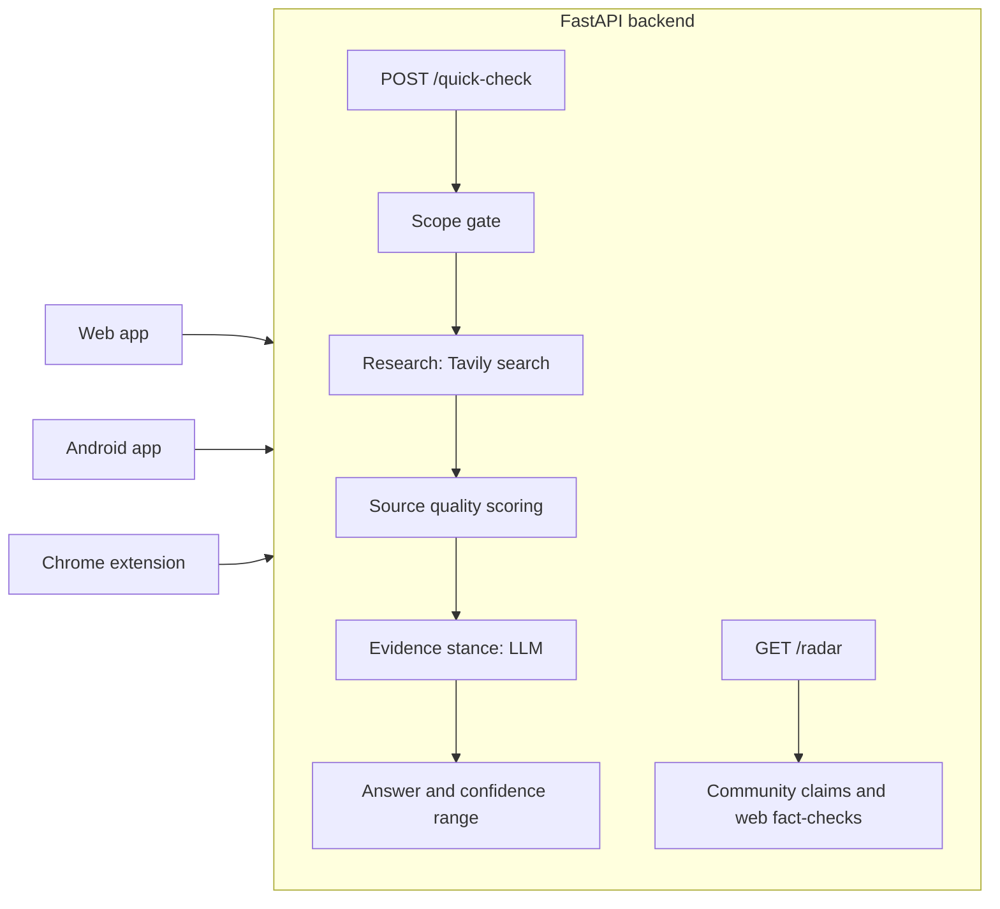

<p align="center">
  
</p>

<h1 align="center">Veritus AI</h1>
<p align="center"><b>Check it before you share it.</b><br/>
A privacy-first misinformation checker for the web, Android and Chrome, built by team <b>Neural Nomads</b> for Code//Connect '26 (Problem 03: Misinformation Control).</p>

<p align="center">
  
  
  
</p>

## What it is

Paste a forward, a headline or a screenshot. Veritus AI pulls out the claim that can actually be checked, searches trusted sources, and shows you the evidence with a **confidence range**. It never hands down a bare "true" or "false", and it leaves opinions, jokes, predictions and matters of faith alone, saying why.

It slows false news without censoring anyone: nothing is blocked or removed, people simply get evidence before they hit forward.

| Product | What it does | Docs |
| --- | --- | --- |
| **Web app** | Home, claim checker, Rumor Radar, plus PIN-protected fact-checker and admin pages (Next.js, hosted on Netlify) | [web/](web/README.md) |
| **Android app** | Same features plus share-to-app from WhatsApp and screenshot scanning (Flutter) | [mobile/](mobile/README.md) |
| **Chrome extension** | Select text on any page, right-click, check it (Manifest V3) | [extension/](extension/README.md) |
| **Backend API** | One shared API for all three (FastAPI) | [backend/](backend/README.md) |

**Live:** web app at <https://veritusai.netlify.app>, API at <https://verifi.fastapicloud.dev> (interactive docs at `/docs`). The code and URLs use the working name `verifi`; the product name is Veritus AI.

## Features

- **Evidence, not verdicts.** Every answer shows the sources, whether each supports or contradicts the claim, a source quality score and a confidence range.
- **Knows what not to judge.** Opinion, satire, faith and predictions are marked "Not rated" with a plain explanation of why and what to try instead.
- **Rumor Radar.** A live list of false claims spreading now, each with a "Why it's here" explanation. Claims reported by at least 10 different installs on at least 3 different networks appear first; fact-checker-rated false claims found on the web fill the list up to 5.
- **English, Urdu and Roman Urdu** input, with text normalisation so spelling tricks do not hide a claim.
- **Share to check (Android).** Share a WhatsApp forward or a screenshot straight into the app. Screenshots are read on the device.
- **Listen (Android).** Results can be read aloud.
- **Fact-checker and admin tools (web).** A PIN-protected form for publishing fact-checker responses, and a dashboard of trending claims and report counts. See [web/](web/README.md).

## Privacy by design

- The text you check is **never stored or logged**. All state lives in memory for the length of one request.
- No accounts. Each install gets an anonymous, signed token that expires after 30 days.
- Cached lookups use a **fingerprint prefix** only: a client sends 4 hex characters, never the claim.
- The Rumor Radar stores only the claim fingerprint plus **salted hashes** of the install and of the coarse network (IPv4 /24 or IPv6 /48). No raw tokens, no IP addresses.

## How it works



1. **Scope gate** decides whether the text contains a checkable claim and extracts it.
2. **Research** searches the web for the claim.
3. **Source scoring** rates each source's quality.
4. **Evidence** classifies each source as supporting, contradicting or neutral.
5. **Answer** combines everything into a likely answer and a confidence range.

## Repository layout

```
backend/     FastAPI app: api/ (routes, security), agents/ (research pipeline), core/ (fingerprint, normalise)
web/         Next.js 16 web app
mobile/      Flutter Android app
extension/   Chrome extension (MV3)
shared/      API contract (API.md) and shared data (normalize_map.json)
docs/        Logo and screenshots
```

## Quick start (local)

You need Python 3.11+, Node 20+, and Flutter if you want the app.

```bash
# 1. Backend (from the repo root)
pip install -r backend/requirements.txt
cp .env.example .env            # add GROQ_API_KEY, GROQ_MODEL, TAVILY_API_KEY, set MOCK_MODE=false
uvicorn backend.app.api.main:app --reload --port 8000

# 2. Web
cd web && npm install
echo NEXT_PUBLIC_API_BASE=http://localhost:8000/api/v1 > .env.local
npm run dev                     # http://localhost:3000

# 3. Mobile
cd mobile && flutter pub get
flutter run --dart-define=API_BASE=http://<your-pc-lan-ip>:8000

# 4. Extension: chrome://extensions > Developer mode > Load unpacked > pick extension/
```

With `MOCK_MODE=true` (the backend default) the API returns fixed sample results and needs no keys, which is handy for UI work.

## Deployment

| Part | Host | Notes |
| --- | --- | --- |
| Backend | FastAPI Cloud | `fastapi deploy` from the repo root; env vars set with `fastapi cloud env set` |
| Web | Netlify | Base directory `web`, Next.js runtime plugin, two `NEXT_PUBLIC_` variables |
| Android | APK | `flutter build apk --release` |
| Extension | Load unpacked | No store fee needed for demos |

Details are in each folder's README. The free hosting tier sleeps when idle, so the **first request after a quiet period can take up to a minute**.

## API at a glance

| Method | Path | Purpose |
| --- | --- | --- |
| GET | `/health` | Liveness check |
| POST | `/api/v1/auth/install` | Get an anonymous install token |
| POST | `/api/v1/quick-check` | Check text and get evidence plus a confidence range |
| GET | `/api/v1/lookup/{prefix}` | Look up cached results by 4-hex fingerprint prefix |
| GET | `/api/v1/radar` | Rumor Radar items |

Full contract: [shared/API.md](shared/API.md) and [backend/README.md](backend/README.md).

## Known limits

- Results are **not a verdict**. Weigh the sources yourself.
- On the free tier, memory resets on every restart or sleep, so the claim cache and the radar start empty again. Tokens survive because they are signed.
- Screenshot scanning supports English and Roman Urdu, not Urdu script.
- Limit of 20 checks per hour per install, and 2000 characters per check.

## Team Neural Nomads

| Who | Area |
| --- | --- |
| Ghunain Fayaz | Research agents, Android app, shared contract, integration and deployment |
| Sharjeel | API, security, privacy, core |
| Muheed | Chrome extension |
| Emaan | Web app and docs |
