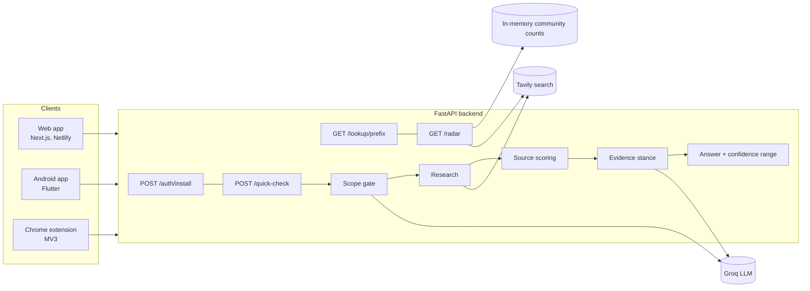

# Veritus AI: Project Documentation

Team **Bug Beaters** · Code//Connect '26, Problem 03 (Misinformation Control)

<p align="center"></p>

> **Check it before you share it.** Veritus AI is a privacy-first misinformation checker with a web app, an Android app, a Chrome extension and one shared backend API.

The product is called **Veritus AI**. The code, the API host and some screens still use the working name **verifi** (for example `verifi.fastapicloud.dev`). They are the same project.

This is the complete reference for the project. For quick start steps, see the README inside each folder (`web/`, `mobile/`, `extension/`, `backend/`). For security, see [THREAT_MODEL.md](THREAT_MODEL.md). For the pitch and demo, see [pitch-and-demo.md](pitch-and-demo.md).

## Contents

1. [Overview](#1-overview)
2. [Product tour](#2-product-tour)
3. [System architecture](#3-system-architecture)
4. [The checking pipeline](#4-the-checking-pipeline)
5. [Backend API](#5-backend-api)
6. [Rumor Radar](#6-rumor-radar)
7. [Privacy design](#7-privacy-design)
8. [Web app](#8-web-app)
9. [Android app](#9-android-app)
10. [Chrome extension](#10-chrome-extension)
11. [Configuration reference](#11-configuration-reference)
12. [Run everything locally](#12-run-everything-locally)
13. [Deployment](#13-deployment)
14. [Testing](#14-testing)
15. [Troubleshooting](#15-troubleshooting)
16. [Known limits](#16-known-limits)
17. [Roadmap](#17-roadmap)
18. [Team](#18-team)
19. [Glossary](#19-glossary)

---

## 1. Overview

### The problem

People share first and check later. In a COVID-19 survey of 365 Pakistani residents (July 2020, Esculapio journal), only 31% checked whether information was true before passing it on, and WhatsApp was the most common place they met misinformation (32%). The sample was small and online, so treat it as an indicator, not a national figure. Private chats and groups mean nobody sees or corrects a false forward, and fact-checks are slow and hard to find in the moment.

### The solution

Paste a forward, a headline or a screenshot. Veritus AI:

1. pulls out the part that can actually be checked,
2. searches trusted sources,
3. rates each source's quality and whether it supports or contradicts the claim,
4. shows a **likely answer with a confidence range** and the evidence behind it.

### Design principles

| Principle | What it means in practice |
| --- | --- |
| Evidence, not verdicts | Every answer shows sources, stance, a source quality score and a confidence range. There is never a bare "true" or "false". |
| Know what not to judge | Opinion, satire, faith and predictions are marked **Not rated** with a plain reason and a suggestion of what to try instead. |
| Slow, do not censor | Nothing is blocked or removed. People simply get evidence before they hit forward. |
| Privacy first | No accounts. The text you check is never stored or logged. |
| Honest uncertainty | "Not enough evidence to say" is a valid answer. The UI says "Not a verdict. Weigh the sources yourself." |
| Built for Pakistan | English, Urdu and Roman Urdu input, with normalisation so spelling tricks do not hide a claim. |

### Products at a glance

| Product | Stack | Hosted at | Folder |
| --- | --- | --- | --- |
| Web app | Next.js 16, React, TypeScript, Tailwind CSS v4 | Netlify, <https://veritusai.netlify.app> | `web/` |
| Android app | Flutter (Dart 3.7+) | APK, installed by hand | `mobile/` |
| Chrome extension | Manifest V3, plain JavaScript | Load unpacked | `extension/` |
| Backend API | FastAPI (Python 3.11+), Groq LLM, Tavily search | FastAPI Cloud, <https://verifi.fastapicloud.dev> (docs at `/docs`) | `backend/` |
| Shared contract | `shared/API.md`, `shared/normalize_map.json` | in the repo | `shared/` |

---

## 2. Product tour

| Screen | Image |
| --- | --- |
| Web home |  |
| Web check |  |
| Web Rumor Radar |  |
| Web PIN screen |  |
| Web admin view |  |
| Web fact-checker form |  |

Mobile:

<p>
  
  
  
  
  
  
</p>

Chrome extension:

<p>
  
  
  
</p>

### How a result reads

A result card contains, from top to bottom:

- **Verdict chip**, for example "Likely true", "Likely false", or "Not rated".
- **Claim checked**: the claim the system extracted from your text.
- **Likely answer**: one sentence such as "Most likely true: sources support this claim. Strongest source: htop.org."
- **Confidence range**: a bar and a low-to-high percentage, for example 54% to 93%. A wide range means the evidence is thin or mixed.
- **Evidence list**: for each source the title, publisher, a **Supports / Contradicts / Neutral** tag, a quality score (for example "Quality 50%"), and a snippet. Links open in a new tab.
- **Freshness**: whether the answer is a "Fresh check" or came from cache, and how long it took.
- **Disclaimer**: "Not a verdict. Weigh the sources yourself before you forward."

If the text is not a checkable claim, the card shows **Not rated**, with the reason (opinion, satire, faith, prediction or too vague) and what to try instead.

---

## 3. System architecture



### Key decisions

- **One backend for everything.** All three clients speak the same API, so behaviour and rules are identical everywhere.
- **Stateless in practice.** All server state (cache, rate limits, radar) lives in memory. This keeps privacy simple, and costs nothing to run, at the price of losing state on restart.
- **Signed tokens instead of accounts.** Install tokens are signed with `TOKEN_SECRET`, so they stay valid across restarts and across instances without a database.
- **Client-side fingerprinting.** The web app, the Android app and the backend all implement the same normalisation and SimHash fingerprint, using the shared `shared/normalize_map.json`.
- **Mock mode.** `MOCK_MODE=true` returns fixed sample results with no keys, so UI work does not need the real pipeline.

### Repository layout

```
backend/     FastAPI app
  app/api/       Routes (auth, quick-check, lookup, radar), settings, security, rate limits
  app/agents/    Research pipeline: claim -> research -> source -> evidence -> answer (Tavily + Groq)
  app/core/      Normalisation and claim fingerprinting (simhash)
  tests/         pytest suite (no network needed)
web/         Next.js 16 web app
mobile/      Flutter Android app
extension/   Chrome extension (MV3)
shared/      API contract (API.md) and shared data (normalize_map.json)
docs/        Logo, screenshots, threat model, pitch and this document
.env.example Backend settings template
```

---

## 4. The checking pipeline

`POST /api/v1/quick-check` runs five stages. Each stage lives in `backend/app/agents/`.

| # | Stage | What it does | Uses |
| --- | --- | --- | --- |
| 1 | **Scope gate (claim)** | Decides whether the text holds a checkable factual claim and extracts it. Opinion, satire, faith, predictions and vague text are refused here and returned as `checkable: false` with a `reason_unchecked`. | Groq LLM |
| 2 | **Research** | Searches the web for the extracted claim. | Tavily |
| 3 | **Source quality scoring** | Gives each source a quality score, so a health authority outweighs an anonymous blog. | Scoring code in `app/agents/` |
| 4 | **Evidence stance** | Classifies each source as **supporting**, **contradicting** or **neutral** towards the claim. | Groq LLM |
| 5 | **Answer** | Combines stance and quality into a likely answer and a confidence range (`confidence_low` to `confidence_high`). Thin or conflicting evidence produces a wide range or "Not enough evidence to say". | Combination logic in `app/agents/` |

Before the pipeline runs, the text is **normalised** (lowercase, Unicode normalisation, look-alike letters mapped, emoji and zero-width characters removed, Roman Urdu spellings reduced to canonical forms) and a **fingerprint** is computed (SimHash over word 3-grams). Near-identical forwards share the same or a close fingerprint, so repeats are answered from cache (`cached: true`).

### Languages

`lang` accepts `en`, `ur`, `ur-Latn` (Roman Urdu) or `auto`. Android screenshot scanning reads English and Roman Urdu, not Urdu script.

### Timing

A fresh check takes several seconds (the extension screenshot shows 4.8 s). Cached answers are much faster. On the free hosting tier the first request after idle can take up to a minute because the service is asleep. Clients wait up to 60 seconds before giving up.

---

## 5. Backend API

Base URL: `https://verifi.fastapicloud.dev` (production) or `http://localhost:8000` (local). Interactive docs: `/docs`. The full contract is in `shared/API.md`.

### Endpoints

| Method | Path | Auth | Purpose |
| --- | --- | --- | --- |
| GET | `/health` | none | Liveness check, returns `{"status": "ok"}` |
| POST | `/api/v1/auth/install` | none | Returns an anonymous `install_token`, valid 30 days |
| POST | `/api/v1/quick-check` | Bearer | Check text, get evidence and a confidence range |
| GET | `/api/v1/lookup/{prefix}` | Bearer | Cached results for a 4-hex-character fingerprint prefix |
| GET | `/api/v1/radar` | Bearer | Rumor Radar items |

Send the token as `Authorization: Bearer <token>`.

### `POST /api/v1/quick-check`

Request body:

| Field | Type | Notes |
| --- | --- | --- |
| `text` | string | Required, at most 2000 characters |
| `lang` | string | `en`, `ur`, `ur-Latn`, `auto` |
| `source` | string | `web`, `mobile`, `extension` (which client is calling) |

Checkable response:

| Field | Meaning |
| --- | --- |
| `claim` | The claim extracted from the text |
| `likely_answer` | One-sentence answer |
| `confidence_low`, `confidence_high` | The confidence range |
| `evidence[]` | Each item: `title`, `url`, `publisher`, `stance`, `quality`, `snippet` |
| `fingerprint` | The claim fingerprint |
| `cached` | `true` if answered from cache |
| `took_ms` | Time taken |

Text that is not a claim returns `checkable: false` with `reason_unchecked`.

### Example

```bash
B=https://verifi.fastapicloud.dev/api/v1
T=$(curl -s -X POST $B/auth/install -H 'Content-Type: application/json' -d '{}' \
  | python -c 'import sys,json;print(json.load(sys.stdin)["install_token"])')
curl -s -X POST $B/quick-check -H "Authorization: Bearer $T" -H 'Content-Type: application/json' \
  -d '{"text":"Drinking hot water cures dengue fever.","lang":"auto","source":"web"}'
```

### `GET /api/v1/lookup/{prefix}`

The client computes the fingerprint locally and sends only the first 4 hex characters. The server returns cached results that share the prefix, and the client picks the exact match locally. The server never learns the exact claim from a lookup.

### Errors

All errors use `{"error": {"code", "message"}}`.

| Code | HTTP | Meaning |
| --- | --- | --- |
| `invalid_input` | 400 | Bad or oversized input |
| `invalid_token` | 401 | Missing, expired or invalid token. Clients request a new one and retry once |
| `rate_limited` | 429 | Over the hourly limit. Includes a `Retry-After` header |
| `upstream_failed` | 502 | The search or LLM provider failed |
| `timeout` | 504 | The check took too long |

### Limits

20 checks per hour per install, 2000 characters per check. The limit is configurable with `RATE_LIMIT_PER_HOUR`.

---

## 6. Rumor Radar

The Rumor Radar is a live list of false claims spreading now. Each item has:

| Field | Meaning |
| --- | --- |
| `origin` | `community` (reported by Veritus AI users) or `web` (found by fact-checkers on the web) |
| `why` | A short "Why it's here" explanation |
| `source_url`, `publisher` | For `web` items, the fact-check source |

### How items are chosen

1. **Community claims come first.** A claim qualifies when at least `RADAR_MIN_INSTALLS` (10) different installs checked it, on at least `RADAR_MIN_NETWORKS` (3) different networks, within the last `RADAR_WINDOW_HOURS` (168, which is 7 days).
2. **Web fact-checks fill the gap.** If fewer than `RADAR_FILL_TO` (5) qualify, the list is topped up with recent false claims found by fact-checkers (a Tavily search plus an LLM extraction, cached for 3 hours). `RADAR_REGION` (for example `Pakistan`) can bias this to a region, and `RADAR_WEB_ENABLED=false` turns it off.

### Why the threshold exists

Requiring many installs on several networks means one person cannot push a rumor onto the radar alone. It is not a complete defence (see [THREAT_MODEL.md](THREAT_MODEL.md)).

### What is stored

Only the claim fingerprint plus **salted hashes** of the install and of the coarse network (IPv4 /24 or IPv6 /48), in memory. No raw tokens, no IP addresses, no text.

---

## 7. Privacy design

| Rule | How |
| --- | --- |
| Text is never stored or logged | State lives in memory for the length of one request. Only the fingerprint is kept for caching. |
| No accounts | Each install gets an anonymous signed token that expires after 30 days. |
| Private lookup | The client sends a 4-hex-character prefix (1 in 65,536), never the claim. |
| Radar without surveillance | Only fingerprints and salted hashes, in memory. |
| Screenshots stay on the device | Android reads screenshot text on the device with on-device OCR, then checks that text. |
| Minimal extension permissions | Only the right-click menu, the active tab on click, storage for the token, and the one backend host. |

### What leaves the system

A **fresh** check sends the claim text to our backend, and from there to the search provider (Tavily) and the LLM provider (Groq). This is a known limit and is also stated in the threat model. Hosting platforms (FastAPI Cloud, Netlify) keep their own request logs, outside our control.

---

## 8. Web app

Live at <https://veritusai.netlify.app>. Full README: `web/README.md`.

### Pages

| Route | What it is |
| --- | --- |
| `/` | Home with animated particle background, headline and entry points |
| `/check` | Paste text, get a verdict chip, confidence range and evidence. Includes example claims to try. Unrated text explains why |
| `/radar` | Rumor Radar with a "Why it's here" note and source link per claim |
| `/factcheck` | Fact-checker form: API key, claim fingerprint, verdict, explanation, source link, "Publish response". Behind the PIN screen |
| `/admin` | Admin view: trending claim count, total reports, and a table of claim, reports, first seen, last seen. Behind the PIN screen |

> The `/factcheck` and `/admin` pages are extra tools used in the demo. The backend endpoints that serve them are not part of the public API list in section 5. Confirm they are enabled on the deployed backend before demoing them live.

### Tech

Next.js 16 (App Router, Turbopack), React, TypeScript and Tailwind CSS v4. No UI library. The glass look, particles and tilt effect are plain CSS and a small canvas.

### Structure

```
src/app/            page.tsx (home), check/, radar/, factcheck/, admin/, layout.tsx
src/components/     Nav, ParticleField, Tilt, ResultCard, Gate
src/lib/api.ts      Backend client: install token, Bearer header, one retry after a 401
src/lib/types.ts    Shared types for results and radar items
src/lib/mock.ts     Sample data for mock mode
public/logo.png     Logo and favicon
```

### Environment variables

| Variable | Purpose |
| --- | --- |
| `NEXT_PUBLIC_API_BASE` | Backend URL including `/api/v1`, no trailing slash. Production: `https://verifi.fastapicloud.dev/api/v1` |
| `NEXT_PUBLIC_USE_MOCK` | `true` uses built-in sample data, `false` calls the backend |
| `NEXT_PUBLIC_ADMIN_PIN` | PIN for `/factcheck` and `/admin` |

`NEXT_PUBLIC_` values are baked in at build time. Change one, then redeploy.

### The PIN screen

The `Gate` component wraps `/factcheck` and `/admin`. It checks the PIN in the browser and remembers the unlock for the current tab only. This is a **soft lock for casual visitors, not real security**, because the PIN ships inside the site's JavaScript. Never protect anything sensitive with it.

### Token handling

On first use the app calls `/auth/install` and keeps the token in the browser. If any call returns 401, it requests a fresh token and retries once.

---

## 9. Android app

Full README: `mobile/README.md`. Built with Flutter (Dart 3.7 or newer).

### Features

| Feature | Detail |
| --- | --- |
| Three tabs | Home, Check, Radar, with a floating glass tab bar matching the website |
| Check | Paste text or a forward. Verdict chip, confidence range, tappable evidence cards (tap to open, hold to copy) |
| Share to check | Veritus AI appears in Android's share sheet. Share text from WhatsApp or a browser and it opens on the Check tab and runs |
| Scan | Pick a screenshot, text is read on the device (English and Roman Urdu), then checked |
| Listen | Reads the result aloud (text to speech) |
| Rumor Radar | Same list as the website, with "Why it's here" and source links. Pull down to refresh |
| Private | Stores only an anonymous install token on the device |
| Splash | Animated splash with the logo |

### Structure

```
lib/main.dart          App entry, Check tab, error messages
lib/splash.dart        Animated splash with the logo
lib/shell.dart         Tab bar and navigation
lib/home_page.dart     Home tab, particle field
lib/radar_page.dart    Rumor Radar tab
lib/result_card.dart   Result view, evidence tiles, Listen button
lib/glass.dart         Colours, glass cards, buttons, gradient text
lib/api_client.dart    Backend client: token, retry after 401, timeouts
lib/ocr.dart           On-device screenshot text reading
lib/fingerprint.dart, simhash.dart, normalize.dart   Claim fingerprinting
```

### Requirements

Flutter with Dart 3.7+, Android Studio (SDK and Java), and `flutter doctor` showing a green Android toolchain.

### Run

```bash
cd mobile
flutter pub get
flutter run
# local backend, phone and PC on the same Wi-Fi:
flutter run --dart-define=API_BASE=http://<your-pc-lan-ip>:8000
```

The app uses `https://verifi.fastapicloud.dev` by default.

### Build the release APK

1. `pubspec.yaml` must declare the logo asset (`assets/icon/icon.png` under `flutter: assets:`).
2. In `android/app/src/main/AndroidManifest.xml`, keep `<uses-permission android:name="android.permission.INTERNET"/>` above `<application`. Release builds cannot reach the network without it.
3. In `android/app/build.gradle.kts`, set `isMinifyEnabled = false` and `isShrinkResources = false` inside `buildTypes { release { ... } }`. With the shrinker on, release builds crash the `shared_preferences` plugin (`NoSuchMethodError`) and every check fails, while debug builds work.
4. Build:
   ```bash
   flutter clean
   flutter pub get
   flutter build apk --release
   ```
   Output: `build/app/outputs/flutter-apk/app-release.apk`. Copy it to the phone and install it (allow unknown sources).

App icon from the logo: add `flutter_launcher_icons: ^0.14.4` to `dev_dependencies`, configure `flutter_launcher_icons` in `pubspec.yaml` (Android on, iOS off, `assets/icon/icon.png`, adaptive background `#05060F`), then run `dart run flutter_launcher_icons`.

---

## 10. Chrome extension

Full README: `extension/README.md`. Manifest V3, plain JavaScript, no build step.

### Install (no store fee)

1. Open `chrome://extensions` and turn on **Developer mode**.
2. Click **Load unpacked** and choose the `extension` folder (the one containing `manifest.json`).
3. Pin Veritus AI from the puzzle icon.

After changing any file, press the refresh icon on the extension's card.

### Use

| Action | What happens |
| --- | --- |
| Right-click selected text, then **Check with Veritus AI** | A small window opens and runs the check |
| Click the toolbar icon | Text selected on the page is pre-filled. Otherwise paste a claim and press **Check** (or Ctrl+Enter). A counter shows characters out of 2000 |
| **Radar** tab | The same Rumor Radar as the web and app |

The extension cannot read Chrome's own pages (`chrome://`) or the Web Store. Paste the text instead.

### Files

| File | Purpose |
| --- | --- |
| `manifest.json` | Manifest V3 config, permissions, icons |
| `background.js` | Service worker: context menu and the result window |
| `popup.html`, `popup.css`, `popup.js` | The interface: check, results, radar |
| `api.js` | Backend client: stores the install token in `chrome.storage.local`, retries once after a 401 |
| `icons/` | Extension icons |

The backend address is the `BASE` constant at the top of `api.js`.

### Permissions

| Permission | Why |
| --- | --- |
| `contextMenus` | The right-click item |
| `activeTab`, `scripting` | Read the text you selected, only when you click the toolbar icon |
| `storage` | Keep the anonymous install token |
| Host `https://verifi.fastapicloud.dev/*` | Call the backend. No other site is contacted |

The extension sends only the text you choose to check. Nothing is saved or logged, and there is no tracking.

### Publishing

For demos and judging, Load unpacked or sharing the folder is enough. A Chrome Web Store listing needs a developer account with a one-time fee, screenshots, a short privacy statement and Google's review.

---

## 11. Configuration reference

### Backend (`.env`, copy from `.env.example`, never commit it)

| Variable | Default | Purpose |
| --- | --- | --- |
| `MOCK_MODE` | `true` | `false` runs the real pipeline. Set it explicitly in production. `.env.example` ships with `false` |
| `GROQ_API_KEY`, `GROQ_MODEL` | none | LLM provider key and the model name that works for your key |
| `TAVILY_API_KEY` | none | Web search key |
| `TOKEN_SECRET` | random per start | Signs install tokens. Set a long random value so tokens survive restarts and work across instances |
| `RADAR_SALT` | dev value | Salt for the radar hashes. Set a long random value |
| `CORS_ORIGINS` | `http://localhost:3000` | Comma-separated allowed web origins, no trailing slash |
| `RATE_LIMIT_PER_HOUR` | `20` | Checks per install per hour |
| `RADAR_TRUST_FORWARDED` | `false` | Read the client network from `X-Forwarded-For`. Only behind your own proxy |
| `RADAR_PROXY_HOPS` | `1` | How many proxy hops to skip in `X-Forwarded-For` |
| `RADAR_WEB_ENABLED` | `true` | Fill the radar from web fact-checks |
| `RADAR_REGION` | empty | Optional region such as `Pakistan` |
| `RADAR_MIN_INSTALLS` | `10` | Installs needed for a community claim |
| `RADAR_MIN_NETWORKS` | `3` | Networks needed |
| `RADAR_WINDOW_HOURS` | `168` | Activity window |
| `RADAR_FILL_TO` | `5` | Top up to this many items with web fact-checks |

### Web (`web/.env.local`)

See [section 8](#8-web-app). On Netlify also set `NODE_VERSION=20`.

### Mobile

`--dart-define=API_BASE=...` at run or build time overrides the backend URL.

### Extension

Edit the `BASE` constant in `extension/api.js`.

---

## 12. Run everything locally

You need Python 3.11+, Node 20+, and Flutter for the app.

```bash
# 1. Backend, from the repo root
pip install -r backend/requirements.txt
cp .env.example .env     # add GROQ_API_KEY, GROQ_MODEL, TAVILY_API_KEY, set MOCK_MODE=false
uvicorn backend.app.api.main:app --reload --port 8000    # http://localhost:8000/docs

# 2. Web
cd web && npm install
echo NEXT_PUBLIC_API_BASE=http://localhost:8000/api/v1 > .env.local
npm run dev                                              # http://localhost:3000

# 3. Mobile
cd mobile && flutter pub get
flutter run --dart-define=API_BASE=http://<your-pc-lan-ip>:8000

# 4. Extension: chrome://extensions > Developer mode > Load unpacked > pick extension/
#    (change BASE in extension/api.js to point at your local backend)
```

Run the backend from the **repo root**, because the app imports as `backend.app...` and reads `shared/normalize_map.json`.

With `MOCK_MODE=true` the API returns fixed sample results and needs no keys.

---

## 13. Deployment

| Part | Host | Notes |
| --- | --- | --- |
| Backend | FastAPI Cloud | `fastapi deploy` from the repo root. Env vars set with `fastapi cloud env set` |
| Web | Netlify | Base directory `web`, Next.js runtime plugin, two `NEXT_PUBLIC_` variables |
| Android | APK | `flutter build apk --release` |
| Extension | Load unpacked | No store fee needed for demos |

### Backend on FastAPI Cloud

Add a root `pyproject.toml` so the CLI finds the app and installs only the needed dependencies:

```toml
[project]
name = "verifi"
version = "0.1.0"
requires-python = ">=3.11"
dependencies = ["fastapi[standard]>=0.115", "aiohttp>=3.9", "python-dotenv>=1.0", "pydantic>=2"]

[tool.fastapi]
entrypoint = "backend.app.api.main:app"

[tool.setuptools]
py-modules = []

[tool.uv]
package = false
```

Then from the repo root:

```bash
fastapi login
fastapi cloud env set MOCK_MODE false     # repeat for the other variables
fastapi deploy
```

Make sure `shared/normalize_map.json` is committed and included.

### Web on Netlify

1. Import the repo. Base directory `web`, build command `npm run build`.
2. Add `web/netlify.toml` with `command = "npm run build"`, `publish = ".next"` and the plugin `@netlify/plugin-nextjs`.
3. Set `NEXT_PUBLIC_API_BASE`, `NEXT_PUBLIC_USE_MOCK=false` and `NODE_VERSION=20` under Site configuration, then clear the cache and deploy.
4. Allow the site on the backend: `fastapi cloud env set CORS_ORIGINS https://<your-site>.netlify.app`, then `fastapi deploy`.

### Operating notes

- The claim cache, rate limits and radar are in memory. Restarts and sleeping on the free tier clear them. Tokens are signed and keep working.
- The free tier can run more than one replica under load, so cache and radar data may be split between them.
- The first request after idle can take up to a minute.
- Behind a hosting proxy, set `RADAR_TRUST_FORWARDED=true` (and `RADAR_PROXY_HOPS` to match) so the radar sees real client networks. Leave it `false` otherwise.

---

## 14. Testing

- **Backend:** `python -m pytest backend/tests` from the repo root. The suite needs no network.
- **Fingerprint parity:** the Python, TypeScript and Dart fingerprint code must produce the same result for the same text. Use the shared test vectors whenever you touch normalisation or `shared/normalize_map.json`.
- **UI without a backend:** `MOCK_MODE=true` on the backend, or `NEXT_PUBLIC_USE_MOCK=true` on the web.
- **Manual smoke test:** run the curl example in section 5, then check the same claim from web, app and extension.

### Demo checklist

- [ ] Backend is awake (make one request a minute before presenting).
- [ ] `MOCK_MODE=false` on the deployed backend, unless you are demoing sample data (say so out loud).
- [ ] Web `CORS_ORIGINS` includes the Netlify URL.
- [ ] APK on the phone is the latest build.
- [ ] Extension loaded and the right-click item appears.

---

## 15. Troubleshooting

### Backend

| Symptom | Fix |
| --- | --- |
| First request very slow | The free tier was asleep. Wait up to a minute |
| 401 on every call | `TOKEN_SECRET` changed or is missing. Set a fixed value. Clients then fetch a new token |
| 429 | The install hit 20 checks per hour. Wait for `Retry-After` |
| 502 | Check `GROQ_API_KEY`, `GROQ_MODEL` and `TAVILY_API_KEY` |
| Browser calls blocked | Add the exact web origin to `CORS_ORIGINS` with no trailing slash |

### Web

| Symptom | Fix |
| --- | --- |
| Netlify "Page not found" | Add `netlify.toml` with the Next.js plugin, redeploy with a cleared cache |
| "Couldn't reach the server" | `NEXT_PUBLIC_API_BASE` missing at build time or blocked by CORS |
| 404 on `/auth/install` | `NEXT_PUBLIC_API_BASE` is missing `/api/v1` |
| "Module not found" for a file that exists locally | Windows ignores letter case, Netlify does not. Fix with `git mv` in two steps |

### Android

| Symptom | Fix |
| --- | --- |
| "Something went wrong" on the APK, fine in `flutter run` | The code shrinker is on. Turn it off and rebuild |
| Every check fails with a network error | Missing INTERNET permission, or an old APK pointing at a local IP. Rebuild and reinstall |
| R8 "Missing classes" with ML Kit | Use the shrinker-off setting, or add `-dontwarn com.google.mlkit.vision.text.**` |
| Kotlin Gradle Plugin warning from `flutter_tts` | Harmless for now |

### Extension

| Symptom | Fix |
| --- | --- |
| Error in the popup | `chrome://extensions`, **Inspect views**, read the first red console line |
| Right-click item missing | Reload the extension, then reload the page |

---

## 16. Known limits

- Results are **not a verdict**. Users should weigh the sources.
- On the free tier, memory resets on every restart or sleep, so the cache and the radar start empty again. Tokens survive because they are signed.
- Screenshot scanning supports English and Roman Urdu, not Urdu script.
- 20 checks per hour per install and 2000 characters per check.
- Images, voice notes and video are not checked (screenshots are read as text on Android only).
- A fresh check sends text to the search and LLM providers.
- The web PIN is a soft lock, not security.
- Heavy paraphrase or translation can miss the cache and trigger a fresh check.

---

## 17. Roadmap

- A persistent database for cache, radar and rate limits.
- Partner fact-checkers publishing official responses, with verifiable signatures.
- More Urdu script and voice coverage, including Urdu script OCR.
- Public-key pinning in all clients if signed fact-checker answers ship.
- Chrome Web Store listing and a Play Store release.
- A prompt-injection review of the research agents.

---

## 18. Team

**Bug Beaters**

| Who | Area |
| --- | --- |
| Ghunain Fayaz | Research agents, Android app, shared contract, integration and deployment |
| Sharjeel | API, security, privacy, core |
| Muheed | Chrome extension |
| Emaan | Web app and docs |

---

## 19. Glossary

| Term | Meaning |
| --- | --- |
| Claim | A statement that can be checked against evidence |
| Scope gate | The first stage, which decides what is checkable |
| Stance | Whether a source supports, contradicts or is neutral to a claim |
| Confidence range | Low to high percentage showing how sure the system is. Wide means unsure |
| Fingerprint | A short SimHash code of the normalised claim, used for caching and the radar |
| Prefix | The first 4 hex characters of a fingerprint, used for private lookup |
| Install token | The anonymous signed token each install uses instead of an account |
| Rumor Radar | The live list of false claims spreading now |
| Mock mode | Backend mode that returns fixed sample answers |
