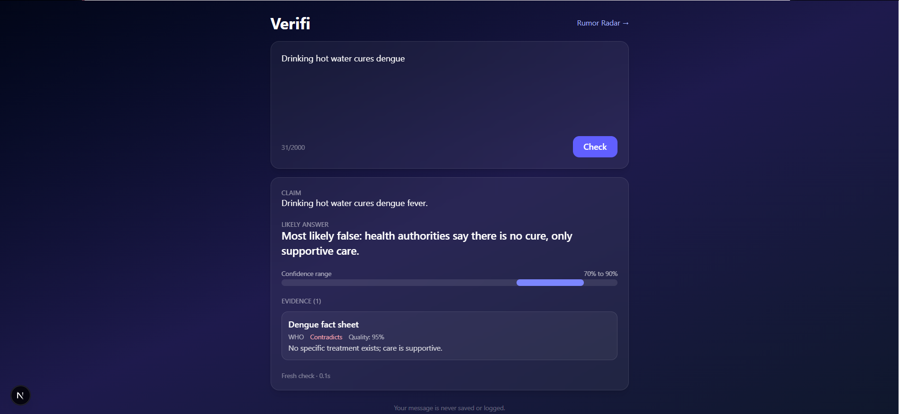
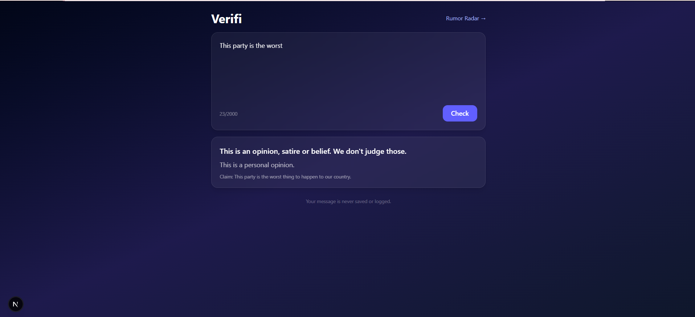
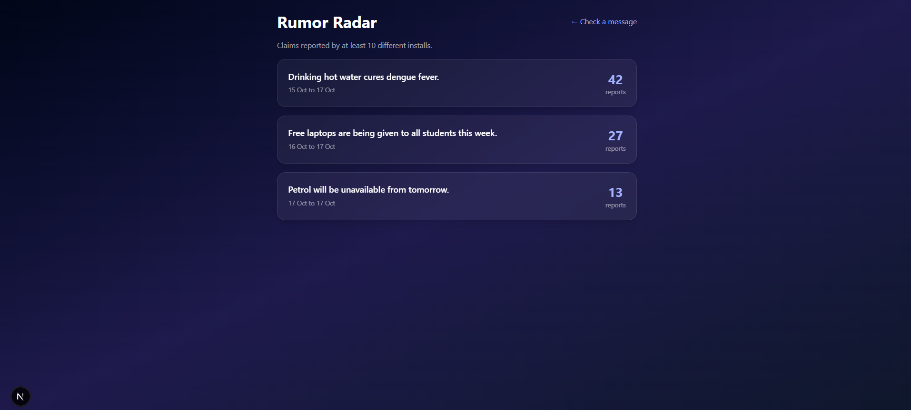
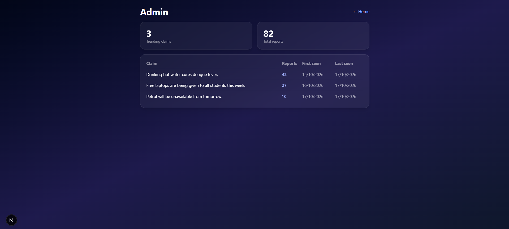
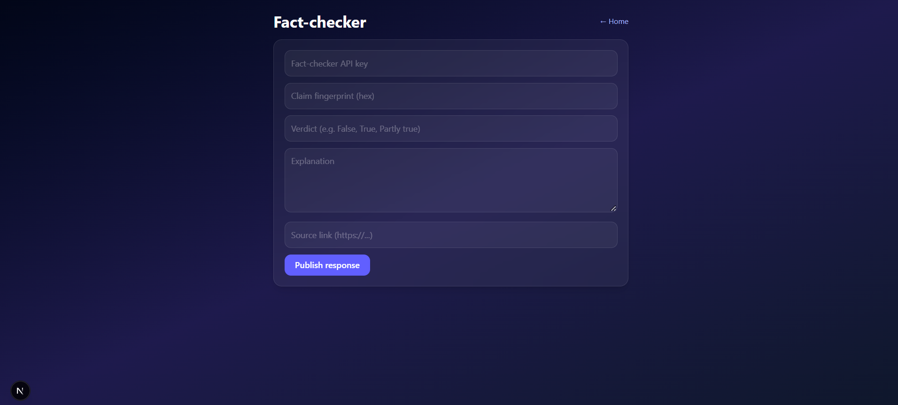

# Verifi: pitch outline and demo script

Team Bug Beaters · Code//Connect, Problem 03 (Misinformation Control)

Deck file: `docs/pitch-deck.pptx`
Demo video link: _add the unlisted YouTube or Drive link here_

## 1. One-line pitch

Verifi lets anyone check a rumor before sharing it: paste or share a message, and get a likely answer with a confidence range and sources, without the server ever storing what you wrote.

## 2. Pitch outline (7 slides)

| # | Slide | Main point |
|---|---|---|
| 1 | Title | Verifi: check a rumor before you share it |
| 2 | Problem | Only 31% of 365 surveyed Pakistani residents checked information before passing it on (COVID-19 survey, July 2020, Esculapio journal). WhatsApp was the most common place they met misinformation. |
| 3 | Solution | Send, research, understand. Range plus evidence, never a bare TRUE or FALSE. Opinions, satire and religion are not judged. |
| 4 | Product | Mobile app, browser extension, web app, one backend and one API contract |
| 5 | Privacy | Text is processed in memory only. Private lookup by 4-character prefix. Radar needs 10 installs on 3 networks. |
| 6 | Abuse protection | Rate limits, input limits, normalization, signed fact-checker answers. Full list in `THREAT_MODEL.md`. |
| 7 | Next steps and team | Private lookup, live radar, partner fact-checkers, more Urdu coverage |

## 3. Demo video script (about 2.5 minutes)

Set up before recording:
- Web app running with `NEXT_PUBLIC_USE_MOCK=true` (sample data) or against the real backend.
- Browser zoom at 80 to 100 percent, tabs and bookmarks bar hidden.
- Windows: press `Win + G` to record, or use OBS.
- Rehearse once.

| Time | Screen | Say |
|---|---|---|
| 0:00 to 0:15 | Slide 1 or the home page | "Rumors spread on WhatsApp faster than anyone can fact-check them. Verifi lets you check a message before you forward it." |
| 0:15 to 0:50 | Home page `/`. Paste "Drinking hot water cures dengue" and press Check. | "I paste a message. Verifi pulls out the claim, researches it and shows a likely answer. Notice it gives a confidence range and the sources, not just true or false." Point at the range bar and the WHO evidence card. |
| 0:50 to 1:10 | Paste "This party is the worst" and press Check. | "Verifi does not judge opinions, satire or beliefs. It says so and tells you why. This keeps it from becoming a censorship tool." |
| 1:10 to 1:25 | Paste "maybe unknown" and press Check. | "When the evidence is thin, it says 'Not enough evidence to say'. That is an honest answer." (Mock mode only. Skip if using the real backend.) |
| 1:25 to 1:50 | `/radar` | "The Rumor Radar shows claims many different people reported. A claim appears only after 10 installs on 3 networks, so one person cannot push a rumor." |
| 1:50 to 2:05 | `/admin` | "Admins see how many claims are trending and the total reports." |
| 2:05 to 2:20 | `/factcheck` | "Fact-checkers publish official answers with their own key. Answers are signed so users can verify them." |
| 2:20 to 2:40 | Slide 5 (Privacy) | "There are no accounts. Message text is processed in memory and never stored or logged. Lookups send only a 4-character prefix, so the server never learns the exact message." |
| 2:40 to 2:50 | Slide 7 or home page | "Verifi: check before you share." |

Notes:
- If the demo runs on mock data, say "sample data" once, so the demo is honest.
- Keep each step to the time shown. If you run long, drop the admin step.
- After recording, upload as unlisted on YouTube or Google Drive and paste the link at the top of this file. Do not commit the video file to the repo.

## 4. Screenshots

## 5. Likely judge questions

| Question | Short answer |
|---|---|
| Does Verifi store my messages? | No. Text is processed in memory for one request and never stored or logged. The server keeps only fingerprints and counts. |
| Can someone fake a rumor onto the radar? | Not alone. A claim needs 10 installs on 3 networks, and reports carry client-side noise. A large, coordinated attacker is a residual risk, listed in the threat model. |
| What if Verifi is wrong? | It always shows a range plus sources, can say "Not enough evidence", and refuses opinions. The UI invites users to read the sources. |
| What does Verifi send to outside providers? | A fresh check sends text to the research and LLM providers. This is stated in the threat model as a known limit. |
| What is not finished? | Listed in `THREAT_MODEL.md`, section 5 (open items). |
